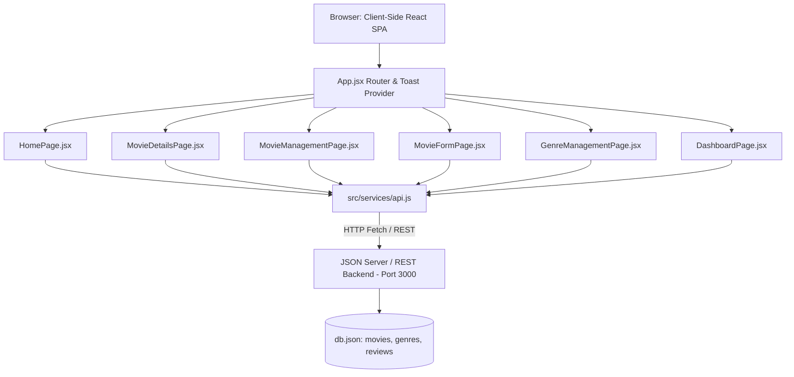

# 🎓 Project Explanation Document: Movie & Entertainment Management Portal

**Course / Project Title:** College Capstone Project — Movie & Entertainment Management Portal  
**Application Name:** CinePortal  
**Author:** Senior React Developer  
**Tech Stack:** React 19, React Router DOM v7, Pure CSS3, JSON Server REST API, Fetch API  

---

## 1. Executive Summary & Problem Statement

Modern media consumers and content administrators require an intuitive, responsive, and aesthetically pleasing platform to explore, categorize, review, and maintain movie catalogs. 

The **Movie & Entertainment Management Portal (CinePortal)** addresses this challenge by implementing a decoupled Single Page Application (SPA) architecture. The presentation layer is built with React and Vite, connected via a centralized API service layer to a RESTful backend powered by JSON Server on port 3000. Data persistence is guaranteed across three primary entities: `movies`, `genres`, and `reviews`.

---

## 2. System Architecture



### Decoupled Data Flow
1. **Zero Hardcoded Data**: All domain entities originate from the JSON Server backend.
2. **Centralized Service Layer (`src/services/api.js`)**: Encapsulates all network communication, headers, error parsing, and serialization. Component files never call `fetch()` directly; instead, they consume asynchronous service functions.
3. **Optimistic & Synchronized UI**: Mutations (POST, PUT, DELETE) trigger state synchronization so that view changes reflect immediately without requiring a full browser refresh.

---

## 3. Core React Concepts Utilized

The application is engineered strictly around modern React standards:

### 3.1 Functional Components & Composition
Every component in the project is written as a pure JavaScript function returning JSX. Reusable elements (e.g., `MovieCard`, `HeroBanner`, `FilterBar`, `StatCard`, `ReviewForm`, `ConfirmationModal`) accept props to customize behavior and presentation, maximizing DRY (Don't Repeat Yourself) code reuse.

### 3.2 State Management with `useState`
- **Catalog Filtering**: Manages search queries (`searchTitle`), active genre (`selectedGenre`), active release year (`selectedYear`), and sorting criteria (`sortBy`).
- **Form States**: Manages multi-field form inputs (`formData`) for movies and genres with real-time two-way data binding.
- **Validation Feedback**: `errors` state objects store field-specific error messages displayed inline upon failed validation.
- **Modal & Feedback Controls**: Tracks visibility states of confirmation dialogs (`isOpen`), loading spinners (`loading`, `submitting`), and active toast notifications.

### 3.3 Side Effects with `useEffect`
- **Data Fetching on Mount**: Runs once on component mount to retrieve initial collections from JSON Server using `Promise.all([api.getAllMovies(), api.getAllGenres()])`.
- **Route Parameter Synchronization**: Listens to changes in `:id` route parameters in `MovieDetailsPage` and `MovieFormPage` to fetch individual movie records.
- **Keyboard Event Listeners**: Closes accessible modal dialogs upon pressing the `Escape` key and cleans up listeners upon unmount.
- **Mount Integrity**: Utilizes `isMounted` cancellation flags to prevent state updates on unmounted components.

### 3.4 Performance Optimization with `useMemo`
- **Dynamic Filter Execution**: `useMemo` recalculates the filtered and sorted movie array only when `movies`, `searchTitle`, `selectedGenre`, `selectedYear`, or `sortBy` change, preventing redundant computations during re-renders.
- **Distinct Value Aggregation**: Dynamically extracts unique release years from catalog records for the filter dropdown without duplicate scans.
- **Dashboard Metrics Aggregation**: Aggregates average ratings, highest-rated movies, and genre distribution percentages in a memoized computation pipeline.

### 3.5 React Context API (`ToastNotification.jsx`)
- Implements `ToastProvider` and a custom `useToast()` hook to allow any page or component to trigger success, error, or info alerts seamlessly throughout the application lifecycle.

### 3.6 React Router DOM Navigation
- Dynamic route parameters (`/movies/:id`, `/movies/edit/:id`).
- Programmatic redirection using the `useNavigate` hook after creating or deleting records.
- Active navigation link indicators using `NavLink` with visual state highlights.

---

## 4. Database Schema (`db.json`)

```json
{
  "movies": [
    {
      "id": "1",
      "title": "Inception",
      "director": "Christopher Nolan",
      "genre": "Sci-Fi",
      "releaseYear": 2010,
      "rating": 8.8,
      "duration": "148 min",
      "poster": "https://images.unsplash.com/...",
      "backdrop": "https://images.unsplash.com/...",
      "synopsis": "A thief who steals corporate secrets through dream-sharing...",
      "cast": ["Leonardo DiCaprio", "Joseph Gordon-Levitt", "Elliot Page"],
      "featured": true
    }
  ],
  "genres": [
    {
      "id": "1",
      "name": "Sci-Fi",
      "description": "Science fiction speculative fiction exploring futuristic concepts..."
    }
  ],
  "reviews": [
    {
      "id": "1",
      "movieId": "1",
      "reviewerName": "Sarah Jenkins",
      "rating": 9,
      "comment": "An extraordinary cinematic tour de force...",
      "createdAt": "2026-01-14T18:30:00.000Z"
    }
  ]
}
```

---

## 5. Component Breakdown & Hierarchy

| Component | Path | Responsibility |
|---|---|---|
| **`App`** | `src/App.jsx` | Configures global router, layout shell, and toast alert provider. |
| **`Navbar`** | `src/components/Navbar.jsx` | Cinematic branding, navigation links, and mobile drawer toggle. |
| **`Footer`** | `src/components/Footer.jsx` | Application footer with quick links and capstone copyright. |
| **`MovieCard`** | `src/components/MovieCard.jsx` | Reusable card rendering movie poster, genre pill, year badge, rating, and actions. |
| **`HeroBanner`** | `src/components/HeroBanner.jsx` | Wide cinematic backdrop banner spotlighting featured films. |
| **`FilterBar`** | `src/components/FilterBar.jsx` | Search input, genre selector, year selector, sorter, and clear button. |
| **`ReviewForm`** | `src/components/ReviewForm.jsx` | Interactive 10-star rating selector and critique submission with validation. |
| **`ReviewList`** | `src/components/ReviewList.jsx` | Renders user reviews, dates, ratings, and deletion controls. |
| **`StatCard`** | `src/components/StatCard.jsx` | Visual KPI metric card for the Admin Dashboard. |
| **`ConfirmationModal`**| `src/components/ConfirmationModal.jsx` | Accessible deletion confirmation dialog. |
| **`GenreModal`** | `src/components/GenreModal.jsx` | Modal dialog for creating (POST) and updating (PUT) genres. |
| **`ToastNotification`**| `src/components/ToastNotification.jsx` | Toast provider and floating alert notifications. |
| **`HomePage`** | `src/pages/HomePage.jsx` | Public catalog with spotlight, filter engine, and movie grid. |
| **`MovieDetailsPage`**| `src/pages/MovieDetailsPage.jsx` | Deep movie profile, cast badges, and audience review system. |
| **`DashboardPage`** | `src/pages/DashboardPage.jsx` | Dynamic statistics, genre distribution bars, and top 5 leaderboard. |
| **`MovieManagementPage`**| `src/pages/MovieManagementPage.jsx`| Tabular admin inventory view with quick edit/delete actions. |
| **`MovieFormPage`** | `src/pages/MovieFormPage.jsx` | Form for adding (POST) or editing (PUT) movie records with live poster preview. |
| **`GenreManagementPage`**| `src/pages/GenreManagementPage.jsx`| Complete CRUD interface for taxonomy classifications. |
| **`NotFoundPage`** | `src/pages/NotFoundPage.jsx` | Cinema-themed 404 handler. |

---

## 6. API Service Layer Specification (`src/services/api.js`)

The API layer maps directly to REST conventions:

```javascript
// Movies
getAllMovies(filters)   // GET /movies or /movies?genre=...&q=...
getMovieById(id)        // GET /movies/:id
createMovie(movieData)  // POST /movies
updateMovie(id, data)   // PUT /movies/:id
deleteMovie(id)         // DELETE /movies/:id

// Genres
getAllGenres()          // GET /genres
getGenreById(id)        // GET /genres/:id
createGenre(genreData)  // POST /genres
updateGenre(id, data)   // PUT /genres/:id
deleteGenre(id)         // DELETE /genres/:id

// Reviews
getAllReviews()         // GET /reviews
getReviewsByMovieId(id) // GET /reviews?movieId=:id
createReview(data)      // POST /reviews
deleteReview(id)        // DELETE /reviews/:id
```

---

## 7. Form Validation & User Experience (UX)

Client-side validation is implemented natively without third-party form bloat:
1. **Movie Form**:
   - **Title**: Required, min 2 characters.
   - **Director**: Required.
   - **Genre**: Required selection from backend genres.
   - **Release Year**: Numerical range check (1888 to Current Year + 5).
   - **Rating**: Floating point number between 0.0 and 10.0.
   - **Duration**: Required format.
   - **Poster URL**: Valid HTTP/HTTPS protocol validation with immediate live preview rendering.
   - **Synopsis**: Required, min 15 characters.
2. **Review Form**:
   - **Name**: Required, min 2 characters.
   - **Rating**: Mandatory star selection between 1 and 10.
   - **Comment**: Required critique text, min 10 characters.
3. **Genre Form**:
   - **Name**: Required, min 2 characters.
   - **Description**: Required thematic definition.
4. **Safety Confirmation**:
   - Direct deletion is prevented; user must confirm via an accessible modal dialog before sending `DELETE` requests.

---

## 8. Conclusion

The **Movie & Entertainment Management Portal** exemplifies full-cycle modern React engineering:
- Adheres to component-driven design principles.
- Decouples UI from data via a centralized REST API service layer.
- Employs responsive, accessible pure CSS3 aesthetics.
- Delivers a robust user experience across public viewing, audience interaction, and administrative management.
